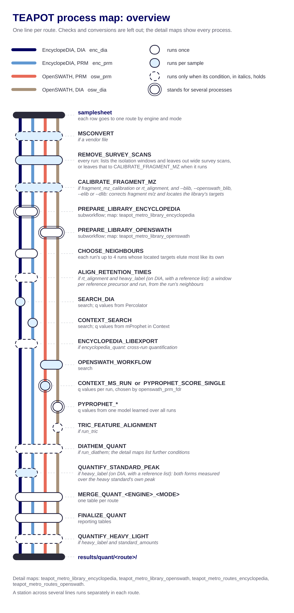

# TEAPOT internals

For developers.

---

## 1. Layout and routing

```
main.nf                 samplesheet parsing, pre-flight checks, routing. Runs no tools itself
nextflow.config         every parameter and its default; profiles
conf/base.config        resource defaults, always included
conf/slurm.config       site overrides, added with -c
subworkflows/local/     8: four routes, PREPARE_LIBRARY_ENCYCLOPEDIA/_OPENSWATH, PREPARE_BACKGROUND,
                        PREPARE_CHROMATOGRAM_LIBRARY
modules/local/<domain>/ 50 processes, one per file
bin/                    Python called by modules, on PATH inside every task
lib/                    Groovy helpers, loaded automatically by Nextflow
assets/                 sentinels, the decoy jar and its source, Wine's CPU list for MSCONVERT
templates/              params, samplesheet and launcher templates
figs/                   figures
*.md                    docs
```

`main.nf` sends each samplesheet row to one route by `engine` (default
`encyclopedia`) and `mode`:

| engine | mode | subworkflow | route label |
|---|---|---|---|
| encyclopedia | DIA | `ENCYCLOPEDIA_DIA` | `enc_dia` |
| encyclopedia | PRM | `ENCYCLOPEDIA_PRM` | `enc_prm` |
| openswath | DIA | `OPENSWATH_DIA` | `osw_dia` |
| openswath | PRM | `OPENSWATH_PRM` | `osw_prm` |

Before routing, vendor files (`.raw`, `.wiff`, `.wiff2`, `.d`, `.lcd`) go through
`MSCONVERT`; `.mzML`/`.mzXML` pass through (`.mzXML` on OpenSWATH routes only:
EncyclopeDIA reads `.dia`, mzML and MGF), and `.dia` is accepted on
EncyclopeDIA routes only. Every run then goes through `REMOVE_SURVEY_SCANS` (§7).
Library preparation runs once per engine:
`PREPARE_LIBRARY_ENCYCLOPEDIA` for the EncyclopeDIA routes,
`PREPARE_LIBRARY_OPENSWATH` for the OpenSWATH routes. Both call
`PREPARE_BACKGROUND` when `background_source` is not `none`. The runs listed in
`library_sheet` or `background_sheet` become a chromatogram library in
`PREPARE_CHROMATOGRAM_LIBRARY`: vendor files converted, the files of a condition
merged, each condition searched, all exported together.

Every route ends the same way: `MERGE_QUANT_<ENGINE>_<MODE>` builds one long
table, `FINALIZE_QUANT` writes the reporting tables, and `QUANTIFY_HEAVY_LIGHT`
runs when `heavy_label` is set and `standard_amounts` is given. Four mergers exist
because the routes expose abundance differently; `FINALIZE_QUANT` is shared, so
the output shape does not depend on the route.

The process map shows every process each route passes, and the condition under
which an optional one runs:



## 2. Naming

The process name is the file name uppercased, and a `bin/` script is named after
the module that calls it. File names fall into three families:

| family | shape | used for | examples |
|---|---|---|---|
| action | `verb_object` | a step we implement | `harmonize_rt`, `complete_channels`, `strip_reference_decoys` |
| conversion | `<from>_to_<to>` | format in, format out | `blib_to_dlib`, `dlib_to_openswath_tsv`, `pyprophet_to_psm` |
| tool wrapper | `<tool>_<subcommand>` | a thin wrapper around a named upstream command | `openswath_workflow`, `pyprophet_learn`, `encyclopedia_libexport` |

Tool wrappers keep upstream's spelling (`OPENSWATH_WORKFLOW` after
`OpenSwathWorkflow`) so the name can be searched in the tool's own documentation.

Otherwise: `snake_case` and no abbreviations (`openswath`, not `osw`), except in
route labels and output paths. Tool-specific
params are prefixed with the tool. Subworkflows are `<engine>_<mode>` or
`prepare_<thing>[_<engine>]`; templates are `<engine>_<acquisition>[_<variant>]`.

Processes without a `publishDir` of their own do not publish `versions.yml`. Where several
processes publish to one folder (`prepare_library/`, `quant/<route>/`, ...), each publishes it
as `<process name in lowercase>.versions.yml`, else the last one would overwrite the others.

Renaming a process means changing its file, its `include`, and its `withName`
selectors in both configs. A stale selector raises no error: the process silently
gets the generic resources (16 GB) instead.

### Context and Context-MS

Two programs with similar names.

* **Context** is Java inside our EncyclopeDIA fork (`contextbook`), run as
  `edu.washington.gs.maccoss.encyclopedia.context.ContextMProphetExecutor` by
  `CONTEXT_SEARCH`. It searches and scores. It is the EncyclopeDIA PRM route.
* **Context-MS** is a Python package in its own image, run as
  `python3 -m context run` by `CONTEXT_MS_RUN`. It does not search: it rescores
  features OpenSwathWorkflow already extracted. It is the default confidence
  estimation option on the OpenSWATH PRM route.

TEAPOT uses neither image named `ghcr.io/shannon225/context`. The images it runs
are `params.encyclopedia_container` and `params.context_container`.

### reference list and mass list

"Reference list" is our term: the samplesheet column `reference_list`, the param
`reference_list_decoy_jar`, the modules `add_decoys_to_reference_list`,
`blib_to_reference_list`, `dlib_to_reference_list`, `normalize_reference_mods`,
`strip_reference_decoys`, and all documentation. "Mass list" appears only where
EncyclopeDIA's own names force it: the `-massList` flag, `MassListDecoyGenerator`,
`IsolationWindowReader.parseMassList`,
`ContextFeatureScorer.findMatchingMassListWindow`, and
`assets/masslist-decoys.jar`. Write `reference_list` in anything new.

## 3. Modules

### `msconvert/`, `runs/`

| module | does |
|---|---|
| `msconvert` | vendor files to mzML (§4): the samplesheet's in `main.nf`, a sheet's in `PREPARE_CHROMATOGRAM_LIBRARY`. A `.wiff` converts to `<name>-<sample>.mzML`, one file per sample it holds, so every `.mzML` written is taken |
| `remove_survey_scans` | every samplesheet run, on every route: lists its isolation windows and removes the scans of survey windows (§7) |

### `encyclopedia/`

| module | does |
|---|---|
| `search_dia` | EncyclopeDIA search. Outputs are named after the full input file name, because EncyclopeDIA appends suffixes |
| `search_gpf`, `merge_gpf` | search the runs a sheet lists (`library_sheet`, `background_sheet`) with `sheet_search_args`: `java -jar` falls through `Main` to the same `Encyclopedia` search as `search_dia`. Named after gas-phase fractionation (GPF) runs; merge the files of one condition into one `.dia` |
| `context_search` | Context: rescores the reference peptides with a model trained on the background |
| `encyclopedia_libexport` | one `-libexport` call: builds a chromatogram library, or the cross-run quant `analysis.elib` |
| `encyclopedia_libexport_per_sample` | a per-sample `.elib` on the PRM route, which the pooled libexport needs for alignment |
| `koina_predict` | FASTA to predicted `.dlib` through Koina |
| `blib_to_dlib` | `.blib` to `.dlib` |
| `blib_to_reference_list` | `.blib` to a reference list (`Compound`, `m/z`, `z`, RT columns) |
| `dlib_to_reference_list` | `.dlib` to the same shape: diathem's targets on OpenSWATH PRM with `diathem_targets_source: library` |
| `dlib_to_openswath_tsv` | `.dlib` to an OpenSWATH transition TSV, mapping delta masses to UniMod |
| `add_decoys_to_reference_list` | adds reversed decoys to a reference list, using `assets/masslist-decoys.jar` |

### `library/`

| module | does |
|---|---|
| `complete_channels` | synthesizes the missing light or heavy twin of each peptide, in either direction, skipping entries whose twin exists and proteins in `complete_channels_skip_proteins` |
| `emit_irt_library` | extracts iRT anchors (and an OpenSWATH iRT TSV) from the original `.blib`, not the channel-completed one |
| `derive_irt_from_reference_list` | iRT anchors from the reference list's RT column (OpenSWATH routes, non-`.blib` sources) |
| `harmonize_rt` | regresses a library's RT onto the anchor scale; can emit a full-window flag when `rt_harmonize_fallback: full_window` |
| `merge_libraries` | unions the reference and background libraries (SQLite). A background exported from several runs holds one entry per peptide and run; only the best-scoring one is kept (lower `Score` is better, as in EncyclopeDIA). A peptide the reference library links to a protein keeps only those links; the background's links are added for the other peptides |
| `assert_rt_coherent` | stops if the two halves of a merged library are not on one RT scale |
| `assert_background_adequate` | stops if the background has fewer than `background_min_targets` peptides |
| `strip_reference_decoys` | decoy-free copy of the reference list, for diathem |
| `restrict_background` | with `background_peptides`: keeps, of a predicted background, the peptides among the `background_peptides_top` a PeptideAtlas build observes most often, or those of a list |
| `normalize_reference_mods` | rewrites a supplied reference list to the library's modification notation (EncyclopeDIA PRM route), see below |

### `openms/`, `context_ms/`, `pyprophet/`, `tric/`

| module | does |
|---|---|
| `openswath_assay_generator` | selects transitions; first stops on duplicated `transition_name` values |
| `openswath_decoy_generator` | appends decoys and writes `library.pqp`; stops on an empty library |
| `openswath_workflow` | the OpenSWATH search. On a run without MS1 scans it turns MS1 scoring off, which otherwise crashes OpenSwathWorkflow |
| `extract_openswath_intensity` | peak areas from the `.osw`: per precursor, of the feature the FDR step identified (its `SpecId` is `f<feature id>_...`), else of the largest peak. It runs after the FDR step for that reason; OpenSWATH reports several candidate peaks per precursor |
| `split_openswath_features`, `context_ms_run` | split features into reference and background, ordered by precursor and retention time (OpenSWATH's feature ids are random), then rescore with Context-MS |
| `pyprophet_score_single`, `pyprophet_to_psm` | the pyprophet alternative on OpenSWATH PRM: one model per run, reshaped to Context-MS's output columns |
| `pyprophet_subsample`, `_merge`, `_learn`, `_apply`, `_export` | OpenSWATH DIA: one model learned over all runs, applied to each |
| `assert_search_productive` | per run, reports how many reference peptides the FDR step identified; stops when every $q$ value is 1 (no decoys). The PRM subworkflows stop when no run identified anything, so one empty run (a blank, a failed injection) does not end a cohort |
| `tric_feature_alignment` | cross-run alignment, OpenSWATH DIA only, when `run_tric` |

### `diathem/`, `quant/`

| module | does |
|---|---|
| `diathem_quant` | interference-corrected quantification over all runs of a route; measures the precursor tolerance that selects each target's own window (§7) |
| `select_diathem_targets` | diathem's targets on a DIA route without a reference list: the precursors identified at $q \le$ `fdr` in at least one run, and the prior library cut to them |
| `augment_context_features` | adds diathem's statistics to Context-MS features (`augment_context_with_diathem`, OpenSWATH PRM) |
| `merge_quant_<engine>_<mode>` | joins identifications and every tool's abundance into one long table |
| `assert_quant_productive` | stops if the quantification `analysis.elib` matched no fragment ions (EncyclopeDIA routes) |
| `finalize_quant` | `quant.full.tsv`, `quant.reference.tsv`, `quant.reference.confident.tsv` and `quant_summary.tsv` |
| `quantify_heavy_light` | light/heavy pairs and absolute pmol |

### `bin/` and `lib/`

`bin/` holds the longer Python bodies: `harmonize_rt.py`, `complete_channels.py`,
`merge_libraries.py`, `assert_rt_coherent.py`, `emit_irt_library.py`,
`derive_irt_from_reference_list.py`,
`normalize_reference_mods.py`, `select_diathem_targets.py`, `remove_survey_scans.py`,
`restrict_background.py`, `diathem_quant.py` (the precursor tolerance `DIATHEM_QUANT`
passes diathem, §7). Shorter modules inline their Python in a heredoc.

`lib/` is required at start-up:

* `Args.groovy`: `flat()` collapses multi-line param strings; `inherit()` copies
  the search flags in `INHERITED_FLAGS` (`-ftol`, `-ptol`, `-frag`, `-fixed`,
  `-enzyme` and their unit/offset flags) into the libexport calls, so quantification
  uses the same tolerances as the search. `-instrument` is not among them (§12).
* `Fingerprint.groovy`: hashes a file or directory (the EncyclopeDIA jar) into the
  task script, so a rebuilt jar invalidates `-resume` caching.

### Decisions behind the modules

**Reference-list decoys differ by engine.** Context's mProphet needs reference
decoys to estimate a reference-side FDR.

* EncyclopeDIA: the reference list is the target set, so decoys are added to the
  list. `ADD_DECOYS_TO_REFERENCE_LIST` runs on a list derived from a `.blib` (in
  `PREPARE_LIBRARY_ENCYCLOPEDIA`), and in `main.nf` on a supplied list that
  `reference_list_has_decoys()` finds without decoy rows (both gated on
  `add_decoys_to_reference_list`).
  Context splits its features by string equality with the list's compounds, and
  a decoy feature is the reversed library entry (§9), so a reference decoy counts
  only if the list holds exactly that reversed string, as the generated decoys do.
  The processed list is what `CONTEXT_SEARCH` receives in every sample row, and
  also what diathem (decoys stripped) and `FINALIZE_QUANT` read. Every EncyclopeDIA
  PRM row names the same supplied list (§6), and every such row gets it.
  Until 2026-10 a supplied list reached `CONTEXT_SEARCH` as the samplesheet file,
  without the generated decoys, so the reference side had no decoys, the null
  Gaussian was degenerate, and a reference q value was 0 exactly when the LDA
  score was above 0.
* EncyclopeDIA: because matching is by string, `C[+57.0]` never equals the
  library's `C[+57.0214635]`. `NORMALIZE_REFERENCE_MODS` rewrites a supplied list,
  before decoys are added. A compound that equals a library `PeptideModSeq` is
  kept. Otherwise it takes the spelling of the library entry with the same
  stripped sequence and the same modification masses (to 0.1 Da) at the same
  positions, if exactly one spelling matches; with several it is kept, because a
  merged library can spell one peptidoform differently in its reference and
  background halves, and picking the background's would move the reference
  peptide into the background. A `.blib`-derived list is not normalized: it is
  built from the same `.blib` as the library. In a supplied list that already has
  decoys, decoy rows match no library entry and keep their notation, even when
  their target is rewritten.
* OpenSWATH: decoys come from the `.pqp`. `SPLIT_OPENSWATH_FEATURES` reads
  `P.DECOY` from the `.osw` and pairs a decoy to its target through
  `DECOY_<target TRAML_ID>`. It uses the reference list only as a set of sequences.
  `main.nf` adds no decoys to an OpenSWATH PRM list, because the same file feeds
  iRT anchor derivation.

**User decoys in an OpenSWATH library are replaced.** Every OpenSWATH source except
`--openswath_pqp` goes through `OPENSWATH_ASSAY_GENERATOR` then
`OPENSWATH_DECOY_GENERATOR`. The assay generator drops decoy entries, and the decoy
generator appends its own, named as the pairing above expects. `--openswath_pqp` is
used as supplied. If its decoys are not named `DECOY_<target TRAML_ID>`, pairing
fails, every reference $q$ value becomes 1, and `SPLIT_OPENSWATH_FEATURES` only warns.

**FDR output is read at peptide level.** Context-MS and pyprophet both write PSM-
and peptide-level tables; the mergers read the peptide level. The PSM table would
admit a peptide when any one spectrum match passed, with no error rate at that
level, and would give one row per match.

**The background has inputs of its own, each with one meaning.** `background_source`
names how the background library is obtained (`library`, `predicted`, `measured`).
`background_library` is a background the user has; `background_fasta` the proteins
potentially in the samples, wherever a FASTA is needed; `background_peptides` the
predicted peptides to keep; `background_sheet` the runs a measured background is built
from; `background_search_library` the library those runs are searched with instead of
a prediction of `background_fasta`. `main.nf` stops on an input the source does not
use, rather than ignoring it, and says which input was meant when
`background_library` comes with `measured` or `background_search_library` with
`library`. `library_sheet`, `--dlib` and `--use_koina` always describe the assay
library, never the background. Every step of `PREPARE_BACKGROUND` that needs a
FASTA gets `background_fasta` rather than `--fasta`, which on SIL runs holds only the
standards: `BlibFile` drops the entries of a `.blib` that no FASTA entry holds.
`measured` searches the runs through `PREPARE_CHROMATOGRAM_LIBRARY`, the same path a
`library_sheet` takes, always with `background_fasta` as `-f` (§12, "A background
needs its own FASTA"). `background_peptides` is either a PeptideAtlas build, ranked by
`n_adjusted_observations`, or a plain list (one peptide per line, or a FASTA of
peptides). A list restricts the prediction rather than replacing `background_fasta`:
`-fastaToKoinaLibrary` digests every FASTA entry, so a FASTA of peptides predicts
their pieces in place of some of them.

#### diathem is under ongoing development

diathem is currently integrated into TEAPOT in its present state, but remains
under active development and subject to future updates.

**diathem's targets.** `diathem quant --targets` reads a delimited list by the
column names `Compound`, `m/z`, `z` (and `RT Time (min)` when present), or a `.pqp`.
It parses modifications only as `[+delta]`: an OpenSWATH `(UniMod:N)` sequence does
not parse and is skipped. It ignores decoy flags and quantifies every row, decoys
included, so it is only ever given targets:

| route | diathem's targets |
|---|---|
| any route with a reference list | the reference list, through `STRIP_REFERENCE_DECOYS` |
| EncyclopeDIA DIA without one | `SELECT_DIATHEM_TARGETS` on the per-run `.encyclopedia.txt` |
| OpenSWATH DIA | `SELECT_DIATHEM_TARGETS` on the per-run pyprophet export, `(UniMod:N)` rewritten as `[+delta]` from `assets/unimod_delta_masses.tsv` |
| OpenSWATH PRM, `diathem_targets_source: library` | `DLIB_TO_REFERENCE_LIST` on the spectral library |

`SELECT_DIATHEM_TARGETS` keeps the precursors at $q \le$ `fdr` in at least one run
(the same `<=` as `detected` downstream), with the median RT of the runs that
identified them. Given the whole library, diathem's DIA runtime grew with the
library rather than with what the runs contain. Because these targets carry a
measured RT, the route passes `DIATHEM_QUANT` a window around it (`--rt-window`, s
either side): diathem holds every target's chromatograms in memory, and over the
whole run a proteome-scale target list exceeded the task's memory; diathem's apex can
also land on another peak far from where the target was identified. The width comes
from the runs. A target identified in one run only is centred on that run, so the
window must hold the whole spread of a precursor's RT across runs:
`SELECT_DIATHEM_TARGETS` takes its 99.9th percentile over the precursors identified
in two or more runs, adds 30 s for the peak and keeps at least 60 s (diathem's own
default). It first leaves out, as misidentifications, identifications whose shift
from their precursor's median RT lies more than 10 robust SDs (1.4826 MAD) from their
run's median shift; on runs searched with the same library at 1 % FDR such an
identification can sit anywhere in the gradient, and one of them sets a precursor's
spread. One run gives 60 s, and fewer than 20 precursors in two or more runs give
180 s. The value reaches `DIATHEM_QUANT` through `rt_window.txt`; the log says how it
was found. Every route with a reference
list reads the whole run (`--rt-window 0`): the list's RT may be on another scale, and
on scheduled PRM each target's own window already limits it to its scheduled time
(§7). `diathem_rt_window` overrides both.

**diathem's prior.** `--library` gives diathem expected fragment ratios. It reads an
`.elib`, `.dlib` or `.blib`, not a `.pqp`, and keys entries by bare sequence and
charge, so a heavy standard and its light twin share one entry. The EncyclopeDIA
routes pass their search library. The OpenSWATH routes pass the spectral library
their `.pqp` was built from (`PREPARE_LIBRARY_OPENSWATH.out.spectral_library`), and
nothing for an OpenSWATH-native source, where diathem runs without a prior.
`diathem_library` overrides both. `SELECT_DIATHEM_TARGETS` cuts an EncyclopeDIA-format
prior to the targets' entries, in their original order, so the lookup is unchanged
and diathem does not load the whole library.

**Testing diathem changes.** `diathem_src` puts a diathem source tree first on
`PYTHONPATH` inside `DIATHEM_QUANT`, so a patched diathem runs without a new image.
The directory must be visible in the container: bind it with `apptainer.runOptions`
in a `-c` config.

**Which runs reach diathem.** diathem reads `*.mzML` only (pyteomics), and needs
every MS2 spectrum to carry an isolation-window target m/z and a scan start time,
one spectrum per time point. `main.nf` enables `DIATHEM_QUANT` on a route when one
of its rows is an `.mzML`, or a vendor file `MSCONVERT` turns into one, and warns
about the rows diathem cannot read (`.dia`, `.mzXML`). Each route builds its own
`sample_map` (`<file stem>`, tab, `<sample_id>`) from the files it receives, after
conversion, so a converted name such as `<name>-001.mzML` still maps to its sample.
`DIATHEM_QUANT` links `mzml_in/<stem>.mzML` to `mzml_dir/<sample_id>.mzML`, because
the mergers take diathem's `run_id` as `sample_id`, and stops if a staged mzML
matches no sample.

## 4. Containers

`nextflow.config` sets `process.container = params.encyclopedia_container` above
the profiles, so the EncyclopeDIA image is the default and every other module
names its own. No profile can omit it. `label` directives are informational; no
config uses `withLabel`.

| image | param | pinned by | modules |
|---|---|---|---|
| EncyclopeDIA fork | `encyclopedia_container` | digest (`6.10.9-teapot`) | the default: `search_dia`, `search_gpf`, `merge_gpf`, `context_search`, both libexports, `koina_predict`, `blib_to_dlib`, `add_decoys_to_reference_list` |
| OpenMS | `openswath_container` | digest | `openswath_workflow`, `_assay_generator`, `_decoy_generator` |
| PyProphet | `pyprophet_container` | digest | the six `pyprophet_*` tool modules |
| Context-MS | `context_container` | tag `main` | `context_ms_run` |
| diathem | `diathem_container` | digest (image of diathem's `teapot` branch) | `diathem_quant` |
| msproteomicstools | none, hardcoded | tag `latest` | `tric_feature_alignment` |
| ProteoWizard | `msconvert_container` | digest | `msconvert` |
| pandas | `python_container` | tag `2.2.1` | the other 28: all of `library/` and `quant/`, every other `assert_*`, `remove_survey_scans`, `select_diathem_targets`, and the Python conversions |

OpenMS and PyProphet were pinned by digest after `latest` changed their CLIs
mid-development. EncyclopeDIA and diathem are pinned to the digests of the images
built from the `teapot` branches of `contextbook` and diathem, whose CI moves the
`teapot` tag (and contextbook's version tag) on every push; update the digests
deliberately when either changes. ProteoWizard is pinned
because `MSCONVERT` depends on its Wine build and its `mywine` wrapper (below).
Images still on moving tags can change under you.

Images are pulled by the Nextflow head job. A pull unpacks the layers in
`APPTAINER_TMPDIR` and caches them in `APPTAINER_CACHEDIR`, both read from the head
job's environment, not from `nextflow.config` (its `env` scope reaches tasks only), so
the launchers in `templates/` export both. Converting the layers to a SIF runs
`mksquashfs` inside the head job, which therefore needs memory for the largest image,
the ProteoWizard one.

The Python image must contain pandas and `ps`: the Nextflow task wrapper exits
without `ps`, and installing pandas at task time needs network and a writable
`$HOME`, which apptainer may not give.

Tool quirks:

* **Context-MS** has no `context` executable on PATH; use `python3 -m context run`.
* **msconvert** is Windows software under Wine (`mywine msconvert`). It needs a
  writable Wine prefix: `containerOptions` binds an empty `/dev/shm` directory to
  `/mywineprefix`, which `mywine` seeds from the image's `/wineprefix64`, and the
  task empties it on exit. It also needs Wine to see at most 64 CPUs: Wine copies the
  online CPU count (`sysconf`, from `/sys/devices/system/cpu/online`) into the
  one-byte `NumberOfProcessors` of `SYSTEM_BASIC_INFORMATION`, so on a node with 256
  CPUs .NET reads 0 processors, divides by it while sizing its GC, and msconvert exits
  255 without output. `containerOptions` binds `assets/wine_cpus_online` (`0-63`)
  over that file. This is why `MSCONVERT` failed on compute nodes and worked on the
  login node, which has fewer CPUs. The binds are apptainer syntax; `MSCONVERT` is
  not set up for the docker profile.
* **Koina** is an HTTPS API, nothing installed. The fork adds a missing trailing
  `/` to `koina_url`. Model names use underscores (`Prosit_2020_HCD`).
* **EncyclopeDIA image**: CI in `contextbook` builds and pushes it on every push to
  the `teapot` branch, tagged with the `pom.xml` version. The base is
  `eclipse-temurin:17-jre-jammy`: the floating `17-jre` tag moved to a base whose
  `date` ignores `%3N`, and Nextflow's wrapper needs 13 digits there, so every
  task failed. CI now checks the digit count.
* **`assets/masslist-decoys.jar`** ships in the repo (§9). A local EncyclopeDIA
  jar can be built with `tools/build_encyclopedia.sh` and used through
  `encyclopedia_jar`, which otherwise points inside the image.

## 5. Configuration

`conf/base.config` is always included. It sets 2 CPUs, 4 h and 16 GB for every
process, plus per-process `withName` blocks sized by what the data needs (for
example 96 GB for `HARMONIZE_RT` and `MERGE_LIBRARIES` on large libraries). Tasks
that exit 137, 139 or 143 are retried once, with the same resources.

Memory is requested as SLURM `--mem` inside `clusterOptions`, not with the
`memory` directive. It therefore applies only under the SLURM executor; local
runs are not memory-limited by Nextflow.

`conf/slurm.config` sets `cluster_options` (the account), the container cache
locations, and 16 `withName` blocks covering 20 processes that benefit from larger
nodes. Three of them (`MERGE_LIBRARIES`, `ASSERT_RT_COHERENT`,
`DERIVE_IRT_FROM_REFERENCE_LIST`) repeat `base.config` exactly; keep this file a
delta so the two cannot drift apart.

Resolution order is the generic `process` scope, then `withLabel`, then
`withName`, and a later `-c` file wins. Do not add `withName: '.*'`: it overrode
`--mem` for processes that had their own selector, and `CONTEXT_SEARCH` was
OOM-killed with 16 GB. Put defaults in the generic scope instead.

## 6. Pre-flight

`main.nf` stops before scheduling anything on:

* missing `assets/` files (`NO_FILE`, `unimod_delta_masses.tsv`, `masslist-decoys.jar`,
  `wine_cpus_online`)
* unfilled `<...>` template placeholders in any param. The check recurses into
  lists and maps: `complete_channels_skip_proteins: ['<iRT_Tag>']` once passed a
  scalar-only check and matched nothing
* an unknown `engine`, a `.dia` file on the OpenSWATH engine, an `.mzXML` on the
  EncyclopeDIA engine, or an invalid `background_source`
* PRM rows that would derive their reference list from a `.blib` with
  `background_source: none` (on OpenSWATH PRM only when `openswath_prm_fdr` is not
  `pyprophet`): the reference set would equal the library, leaving nothing to
  train on
* a `.blib` together with `--library_sheet` or `--elib`, or `--blib` with `--dlib`
  or `--use_koina`: one of them would be dropped
* a background source without its inputs (`library`: `background_library`, and
  `background_fasta` when it is a `.blib`; `predicted`: `background_fasta`;
  `measured`: `background_sheet` and `background_fasta`), a background input the
  source does not use (with a pointed message for `background_library` under
  `measured` and `background_search_library` under `library`), a missing file, a
  `background_library` or `background_search_library` that is not an `.elib`,
  `.dlib` or `.blib`, or a `background_peptides_top` that is not a positive whole
  number
* a background that no library here takes: on EncyclopeDIA only a `.blib` takes
  one, on OpenSWATH every source but `--openswath_pqp`, `_tsv` and `_traml`. When
  one engine takes it and the other does not, a warning. Also warnings when no
  route learns from the background (no EncyclopeDIA PRM, no OpenSWATH PRM with
  Context-MS), and when a SIL `.blib` is searched on a PRM route without one
* a `library_sheet` or `background_sheet` without the columns `condition` and
  `fraction_file`, with an empty cell, a missing file, or a file EncyclopeDIA cannot
  search and `MSCONVERT` does not convert (mzXML, for one)
* rows of one engine and mode that name different `reference_list`s, a blank counting
  as one (OpenSWATH DIA, which reads none, aside): a route processes one list for all
  its runs, from the first row that names one, and on OpenSWATH PRM its iRT anchors
  apply to the whole library
* a `reference_list` that the route cannot read: on EncyclopeDIA PRM, Context and
  the decoy generator read it by position (`Compound`, `Formula`, `Adduct`, `m/z`,
  `z`, `RT Time (min)`, `Window (min)`, optional `isDecoy`); where diathem runs it
  needs the columns `Compound`, `m/z` and `z` by name
* a `primary_abundance` tool that does not run on one of the routes present, which
  would leave `abundance` empty
* an invalid `diathem_weight`, `diathem_max_fragments` or `diathem_baseline`
* an invalid `diathem_targets_source`, or `library` with `--openswath_pqp`, `_tsv`
  or `_traml`, which have no spectral library to take the targets from
* PRM rows with neither a `reference_list` nor a `.blib`
* a route with fewer runs than `quant_min_runs`, when `quant_require_min_runs` is
  set (otherwise a warning)

## 7. Scan selection and OpenSWATH's fragment window

Every route keeps to one rule: a peptide is scored and quantified only in scans
acquired for targeted analysis, and a precursor that has an isolation window of its
own (one centred on its m/z) only in that window. Scheduled PRM breaks naive scan
selection in two ways. Some methods interleave wide survey windows, tens of Th wide
and acquired over the whole run, with the narrow targeted ones. And targeted windows
overlap: the window centred on one precursor often covers other targets, but it is
acquired only around its own target's scheduled time. A precursor scored in a survey
window, or in another target's window, is scored in scans that were not acquired for
it, often at a time its own window was not acquired at all, so the peak found there
can be at the wrong retention time.

**Survey scans are removed before any tool reads a run.** `REMOVE_SURVEY_SCANS` runs
`remove_survey_scans.py` on every samplesheet run, after `MSCONVERT`. A survey window is an
MS2 isolation window that encloses another window of the same run at most a quarter
of its width. When a run has any, the script writes a copy without their scans: an
`.mzML` keeps every other spectrum byte for byte, with the spectrum indices
renumbered and the index and checksum rewritten; a `.dia` loses the matching rows
of `spectra` and `ranges`. Other runs pass through as a link. Tiled DIA windows do
not enclose one another, so DIA runs are unchanged.
`isolation_windows/<sample_id>.isolation_windows.tsv` lists every window with its
scans, RT span and whether it was removed.

The runs of `library_sheet` and `background_sheet` are searched whole, survey scans
included: they only add peptides to a library, and none of their scans is quantified.
A background from the whole runs trained Context at least as well as one from their
survey or their targeted scans alone (§12).

**Own windows, per tool.**

* EncyclopeDIA and Context (`contextbook`). `StripeFile.getStripes` returns every
  scan whose window contains the requested m/z, which on overlapping windows mixes
  in scans acquired for other targets; `IsolationWindowFilter.restrictToWindow`
  keeps only the scans of the window being scored, matching bounds within 0.0005 Th.
  A window's bounds repeat exactly in each of its scans, while the windows of
  near-isobaric targets can differ by a thousandth of a Th, at different scheduled
  times. `IsolationWindowFilter.OwnWindows`
  decides which windows a precursor is scored in: its own window is the one whose
  centre is closest to its m/z, within 0.01 Th, then the narrowest. Scheduled methods
  centre the window on the target m/z, at most rounded to 0.01 Th; a wider tolerance
  would give background precursors a window by coincidence. A precursor that
  has one is scored only there; one that has none, a background peptide, in every
  window that contains it. `Encyclopedia` (the DIA search), `EncyclopediaTwo` (the
  Context PRM search) and `PeptideQuantExtractor` (quantification in `-libexport`)
  apply both. Quantification needs it as much as the search: a PSM extracted from
  several windows is written to the `.elib` once, from the window with the best
  integration score, which need not be its own. The Java property
  `encyclopedia.exactIsolationWindow=false` switches both off; TEAPOT never sets
  it. Tiled DIA windows overlap at most at their edges, where no window is centred,
  so neither changes a DIA search.
* Context matches the reference list by sequence and charge, and keeps the best
  feature per precursor. Keeping the best feature per sequence let a charge state
  the method did not target, scored in another target's window, stand in for the
  targeted precursor.
* OpenSWATH. `OPENSWATH_WORKFLOW` adds `-matching_window_only true` on the PRM route,
  so each assay is extracted from its best-matching window only, unless
  `openswath_search_args` sets the flag. Not on DIA, whose windows tile.
* diathem counts a scan for a target when the scan's isolation target m/z is within
  `--precursor-tol` of the target m/z. `diathem_quant.py` measures,
  over the route's runs, how far each target lies from the nearest isolation target.
  When at least half the targets have one within 0.05 Th, the runs were acquired for
  these targets, and the tolerance is twice the 95th percentile of those distances
  plus 0.0005 Th: each target's own window and no other. The percentile keeps a
  target the method did not acquire, lying near another window by chance, from
  widening it; such targets get no scans, and the log counts them. Scheduled methods
  set the isolation target to the target m/z, while distinct targets can lie a
  hundredth of a Th apart, so a fixed tolerance such as 0.02 Th already mixes in
  other targets' windows. Otherwise
  the default for the samplesheet `mode` applies (12.5 on DIA, 0.5 on PRM).
  `diathem_precursor_tol` overrides it; the value and the reason are in the diathem
  log and `diathem_quant.versions.yml`.

**Retention time.** A target's own window is acquired only around its scheduled
time, so own-window selection is itself the RT restriction on scheduled PRM. diathem
reads the whole run on every route with a reference list (`--rt-window 0`): the
list's RT may be on another scale than the runs (a vendor `.blib`, a method built on
another gradient), and a window centred on it can cut the peak. Targets identified on
DIA carry the RT the runs measured, and there diathem reads a window around it whose
width the runs give (§3).

**OpenSWATH's fragment window.** OpenSWATH reads each transition within half of
`-mz_extraction_window` around its m/z: the value is the window's full width
(`ChromatogramExtractorAlgorithm`: from `mz - window / 2` to `mz + window / 2`), so the
ion-trap templates' `0.4 Th` reads +/-0.2 Th, half EncyclopeDIA's `-ftol 0.4 AMU`.
Ion-trap fragment m/z can be off by more than that. On the SIL QC runs they read high,
by more at high m/z and by different amounts from plate to plate, so the strongest
library fragments fall outside the window: their traces hold noise, OpenSWATH's
library-intensity and co-elution scores fail on a present standard as on its decoy,
and almost nothing passes 1 %. A well-calibrated run given the same error fails the same
way, and a window twice as wide recovers it. A wider window costs detections on a
well-calibrated run, so the window has to follow the runs: it is set in
`openswath_search_args`, and nothing checks it, since measuring the error needs
identified peptides first and a threshold that depends on the engine and the
instrument. OpenSWATH also scores the spectrum at each peak's apex (b and y ions, a dot
product, mass error) at tolerances of its own, `-Scoring:DIAScoring:dia_extraction_window`
(default 0.05 Th) and `dia_byseries_ppm_diff` (10 ppm), which no template sets; set to
the ion trap's tolerance those scores did not help the label-free search.

## 8. Quantification decisions

* **`abundance` is exactly the column of the tool named in `primary_abundance`,
  with no fallback.** A row-wise fallback mixed tools within a light/heavy pair and
  across peptides in one column. `base_quant` calls it `abundance_primary`; the
  reporting tables call it `abundance` and keep an `abundance_<tool>` column for
  each tool with values on the route. Pre-flight refuses a `primary_abundance`
  tool that does not run on a route present.
* **diathem's weighting.** `diathem_weight` (default `nmf5_varexp`) becomes
  `--weight` unless `diathem_args` carries one. `nmf5_varexp` decomposes each
  peptide's (run, scan, fragment) signal into five components and weighs each
  fragment by the share of its variance the peptide's component explains, so a
  fragment that a co-isolated peptide also feeds counts less. Settings for Stellar
  ion-trap PRM were chosen on three yardsticks, each scored only on the rows the
  search detected, paired across settings and tools: fold-change accuracy on the
  T-cell dilution curve and on the mouse 100 % / 10 % pair, and run-to-run
  precision on the 25 plasma SIL QC runs (heavy abundance, and light/heavy ratio).
  With the background term on, `nmf5_varexp` is diathem's most accurate scheme on
  both curves, as in diathem's own PRM bench, and the least precise of those
  tried; the `beta_kl` family (inverse fitted intensity, prmherd's KL loss) is
  more precise but less accurate. EncyclopeDIA is more precise than every diathem
  setting on the SIL QC runs and more accurate near the detection limit, so the
  EncyclopeDIA templates keep `primary_abundance: encyclopedia`; diathem is
  more accurate at moderate fold changes. `poisson`, diathem's default, weights
  the observed intensity, so points that happen to read low weigh more, and is
  the least accurate. The schemes built on diathem's measured noise law
  (`inverse_variance`, `noise_adherence`) are not offered: on an ion trap the
  faint points carry a pedestal of co-isolated signal rather than reading zero,
  and those weights lean on exactly the faint points. Two crops were tried and
  dropped: the bench's +/-45 s crop around the apex helped the single-batch curve
  but hurt the SIL cohort, run over several days, whose retention times drift
  further than the crop's search range; a crop around each precursor's median
  measured retention time made the SIL QC runs less precise. `quant_nmf5`,
  `quant_k2` and the other bench-only methods exist only in diathem's benchmark
  scripts, not in `diathem quant`.
* **diathem as its PRM benchmarks run it.** Those fit only the brightest library
  fragments (eight, from 200 m/z; more fragments trade accuracy at low abundance
  for precision) and the solver's flat per-run, per-transition background term,
  capped below the peak, which absorbs the pedestal. `diathem quant` on diathem
  `main` offers only `poisson` and `uniform`, fits every theoretical b/y fragment
  from 150 m/z, and its `--library-top-k` limits only the prior. diathem's
  `teapot` branch, whose image TEAPOT pins (§4, §10), lets `--weight` take every
  registered scheme that needs no noise model and adds `--max-fragments` and
  `--background`. `DIATHEM_QUANT`
  passes `diathem_weight`, `diathem_max_fragments` (8) and `diathem_baseline`
  (true) where `diathem quant --help` shows them, and otherwise logs that it uses
  `uniform`, every fragment or no baseline. diathem's background term is part of
  the abundance model and unrelated to TEAPOT's background peptides.
* **EncyclopeDIA's amounts come from the cross-run export, detection from each
  run.** `MERGE_QUANT_ENCYCLOPEDIA_*` read `peptidequants` of the `analysis`
  export, while `detected` is each run's own q value. The export runs Percolator
  again over each peptide's best match across all runs and, at its own 1 %, left
  out peptides the runs had detected, so they had no amount. On routes with a
  reference list the `analysis` export therefore runs with `-percolatorThreshold 1`
  (`ENCYCLOPEDIA_LIBEXPORT`'s `quantify_all`): every scored peptide is quantified,
  which adds the missing amounts and leaves every other amount unchanged. The GPF
  library and background exports keep the filter, since there it decides what the
  library holds. A peptide still gets no amount in any run when fewer than
  `-minNumOfQuantitativePeaks` (3) of its fragments trace its peak well across the
  runs: `EncyclopediaTwoPeakLocationInferrer.getArchetypals` picks those fragments,
  `SimplePeakLocationInferrer.getQuantitativeData` returns nothing below the
  minimum, and `LibraryFile` writes no `peptidequants` row. On the plasma SIL
  cohort these are peptides whose vendor library spectrum holds only a few
  fragments, detected or not.
* **An EncyclopeDIA light/heavy ratio sums the same fragments in both forms.** The
  export picks each library entry's quant ions on its own (`getArchetypals` keys them
  by `PeptideModSeq`, one set for every run), so a light peptide and its standard are
  often summed over different fragments, and their two `TotalIntensity` values then
  compare unlike sums. `MERGE_QUANT_ENCYCLOPEDIA_*` read each `peptidequants` row's
  `QuantIonMassArray` and `QuantIonIntensityArray` and label every quant ion:
  EncyclopeDIA writes the theoretical m/z of the ion it annotated, so the label is the
  b, y, c, z or z+1 ion, at the charges `FragmentationModel` annotates, within
  0.005 Th. Where both forms of a precursor have an abundance in a run, each is summed
  over the ions whose label the other form shares, as
  `abundance_encyclopedia_shared_ions`; a form whose ions are all shared keeps its
  `TotalIntensity`. One m/z can be two ions at once (a b and a y ion of equal mass), so
  ions match when their label sets overlap; the label shifts the two ions differently
  in the other form, which breaks the tie. `QUANTIFY_HEAVY_LIGHT` pairs on this column
  and `FINALIZE_QUANT` counts a pair in `pairs_quantified` only when both sums are
  above zero, so the two agree: a form with nothing on the shared ions is unquantified
  in its pair. One shared ion is enough. The per-form tables keep `TotalIntensity`,
  every quant ion of the form, since a form's own abundance needs no partner.
* **Reporting tables (`FINALIZE_QUANT`).** One status: `detected` is
  `q_value <= fdr`. The reference set is the reference list's (peptide, channel)
  pairs, or without a list every pair detected in at least one sample, so a DIA
  route reports the peptides it found rather than everything the search scored.
  `quant.reference.confident.tsv` is the detected rows of `quant.reference.tsv`;
  other peptides, a larger library's or a background's, are only in `quant.full.tsv`.
  Membership ignores charge. The summary counts reference peptides per sample, a
  peptide being detected when any of its charges is, and quantified when the
  `primary_abundance` tool gave that detection an abundance. When the reference
  holds both channels of a peptide it counts light/heavy pairs instead: both
  channels detected at one charge, as `QUANTIFY_HEAVY_LIGHT` pairs them, and
  quantified when the `primary_abundance` tool's two peaks pass the co-elution
  check below, so `pairs_quantified` equals the confident absolute-quant rows (less
  what `min_consistency` drops there). On SIL runs with a reference list, reference
  peptides with no light form in it (an iRT tag's) are neither counted nor shown in
  `quant.reference.tsv` and `quant.reference.confident.tsv`; `quant.full.tsv` keeps them.
  Reference decoys are neither counted nor added as rows. Rows only diathem
  reported take their protein from the same peptide's other rows. A peptide left
  without one (a reference peptide no tool reported, or one only diathem measured)
  takes the FASTA entries that contain it, named as EncyclopeDIA names them (the
  header up to the first space, several joined by `;`). `QUANTIFY_HEAVY_LIGHT` fills
  its pairs the same way, so a pair only diathem measured can still be matched to a
  protein-keyed amount, and an iRT tag's peptide to `complete_channels_skip_proteins`.
  A user's OpenSWATH-native library may name proteins otherwise; only empty cells
  are filled. The tables are written with `\n` line ends.
* **A light/heavy pair must co-elute.** A light peptide and its 13C/15N standard
  elute together, so a ratio of peaks measured at different times compares two
  different peaks. The check compares where each tool measured the two channels,
  not where the search detected them: `rt_encyclopedia_seconds` (the centre of the
  `peptidequants` integration), `rt_diathem_seconds` (diathem's apex), and for
  OpenSWATH and TRIC the identified feature (`rt_apex_seconds`, which on the
  EncyclopeDIA routes is the search's apex, read from `PSMId`). EncyclopeDIA's
  export aligns retention times across runs and integrates each peptide where the
  alignment puts it. By design, that rescues some peaks a run's own search got
  wrong, and pairs it brings together give the ratio the same peptide has in other
  replicate runs; but it also integrates one channel of a pair away from the other,
  and those ratios are as far off as pairs detected apart. On the plasma SIL QC
  runs, replicates of one pool, ratios degrade steadily with the gap between the
  two measured peaks and, beyond about half a peak width, are no better than pairs
  half a minute apart; hence `pair_rt_tolerance_seconds` 9, half the typical peak
  width there. diathem fits each precursor on its own over the whole run, so it
  measures the two channels apart far more often than EncyclopeDIA. `0` turns the
  check off; a pair with a missing retention time is kept and counted in the logs.
* **Absolute-quant tables.** `peptide.abs_quant.tsv` has every light/heavy pair of
  every tool, with a `status`, each channel's `light_detected` and `heavy_detected`,
  the two measured retention times, `co_eluting`, and `confident`, true for exactly
  the rows of `peptide.abs_quant.confident.tsv`, so that table is a filter on one
  column and a reader needs neither the rule nor the `fdr`.
  `peptide.abs_quant.confident.tsv`, the matrix and the protein table all come from
  one set: the `primary_abundance` tool's pairs with both channels detected,
  co-eluting, and a known amount. Pairs of `complete_channels_skip_proteins` are
  dropped rather than listed with a status of their own, and on OpenSWATH DIA only
  the best peak group of each channel is paired. Each tool's pairs come from the
  rows that tool or the search reported. diathem reports every reference precursor
  in every run, and a row only it reported makes no pair of another tool, so
  EncyclopeDIA's and OpenSWATH's rows are the same with diathem on or off, but for
  diathem's own `light_consistency` and `heavy_consistency`. Only precursors with a
  heavy row in some run are paired: one without has no standard, such as a
  background peptide on the PRM route, whose `analysis` export quantifies every
  scored peptide. `QUANTIFY_HEAVY_LIGHT` has no reference list, so a standard whose
  heavy no run reported is left out too; its light alone gives no amount. A channel
  a tool did not quantify is summed with `min_count=1` and stays missing instead of
  becoming 0.
* **No silent empty tables.** `heavy_label` set but no heavy rows in the merged
  table is an error, and so is a table where both channels exist but no pmol could
  be attached.
* **Zero is missing.** Abundances of 0 become NaN before any ratio; otherwise a
  zero heavy gives an infinite, plausible-looking amount.
* **`min_consistency` gates every tool**, not only diathem: diathem's
  `consistency` describes interference in the peptide's signal, which affects all
  tools' abundances.
* **Protein amount is the median**, first over charge states within a peptide,
  then over peptides. With construct-level standards every peptide estimates the
  same amount, so a sum would scale with the number of detected peptides.
* **Join keys.** Each of these once broke a whole table:
  * charge: Percolator and Context encode it only in `PSMId`
    (`<file>:<rt>:<pepModSeq>+<charge>`)
  * channel: a heavy peptide and its light twin share sequence and charge;
    without `channel` every ratio became 1. On OpenSWATH PRM the peptide-level
    $q$ values join on channel too, else a heavy and its light twin took each
    other's
  * flanking residues: Percolator writes `-.PEPTIDE.-`, the `.elib` writes
    `PEPTIDE`
  * file name to sample: each route's `sample_map` is built from the files it
    receives, after `MSCONVERT`; EncyclopeDIA names outputs after the full input
    name, so its stems are matched as prefixes in both directions
* **EncyclopeDIA abundance comes from the `.elib` `peptidequants` table**, which
  keeps precursor charge. `analysis.elib.peptides.txt` sums charges and is read
  only when the `.elib` is missing or empty. libexport writes it only when it
  aligns two or more runs.
* **Standard amounts** can be keyed by peptide (sequence, optional charge) or by
  protein. Protein keys match an accession token or the part before the first `_`.

## 9. The decoy jar

`assets/` holds `NO_FILE` (the optional-input sentinel), `unimod_delta_masses.tsv`,
`samplesheet.example.csv` (the `test` profile), and `masslist-decoys.jar` with its
source `MassListDecoyGenerator.java` and `build_masslist_decoys.sh`.

The jar calls EncyclopeDIA's own `PeptideUtils.reverse`, so its decoys are the ones
the Context search generates (`LibraryEntry.getDecoy`): residue-aware reversal with
fixed termini, no shuffle. `getSmartDecoy`, which shuffles when the reversal
collides or resembles its target, was tried and rejected: its decoys did not exist
in the search space, while the real reversed decoys ended up in the background,
and the missing ones were the high-scoring ones, biasing FDR downwards. Generation
tracks taken sequences, so input order matters.

Build it with `assets/build_masslist_decoys.sh <encyclopedia jar>`. It compiles
with `--release 17`, because the image runs Java 17 and a newer class version
fails at load in `ADD_DECOYS_TO_REFERENCE_LIST`.

## 10. Patched tools

Both are pulled as images; these are the changes an upgrade must keep.

**EncyclopeDIA: `contextbook`, branch `teapot`, image `6.10.9-teapot`.**

| change | why |
|---|---|
| CLI entry points for `ContextMProphetExecutor` and `ContextWindowExtractor` | callable from a pipeline |
| bounds checks on the precursor isotope packet, empty chromatograms and empty traces | crashes on sparse PRM |
| `IsolationWindowFilter`: a window is scored against the scans acquired for it (§7) | overlapping windows on scheduled PRM |
| `IsolationWindowFilter.OwnWindows`: a precursor with a window centred on it is scored and quantified only there; window bounds matched within 0.0005 Th instead of 0.01 (§7). Since `6.10.9-teapot` | otherwise it is also scored in other targets' windows, at times its own was not acquired |
| Context matches the reference list by sequence and charge, best feature per precursor (§7), since `6.10.9-teapot` | per sequence, an untargeted charge state could stand in for the targeted one |
| user-supplied search parameters on the Context path; a `-background`/`-reference` feature-file mode | `-ftol` and friends reach Context |
| `ContextFeatureScorer` splits the features once (§3), since `6.10.9-teapot` | the LDA was trained on duplicated background features and on the reference features it scored |
| `Locale.US` formatting, pi0 capped at 1.0, delimiter auto-detection, optional `isDecoy`, Koina URL helper | correctness |
| real version, unused native dependencies dropped, pinned image base | reproducible, smaller image |
| `pom.xml` names the javacpp and openblas linux-x86_64 jars, since `6.10.9-teapot` | Maven 3.10 no longer resolves them through ND4J's POMs, and ND4J cannot load without them |

**diathem: branch `teapot` of `statisticalbiotechnology/diathem`**, `main` (72d07af)
plus options of `diathem quant`; TEAPOT pins its image by digest. `main` adds
`--fragment-tol-th` (`diathem_fragment_tol_th`). Ion-trap fragment error is
roughly constant in Th, which no single ppm value can express; with ppm tolerances
on ion-trap data the shared fragment-ratio fit collapsed onto one fragment. Without
the flag the ppm behavior is unchanged. The `teapot` branch adds `--weight` with
every registered scheme that needs no noise model (`diathem_weight`), `--max-fragments`,
the fragments the library predicts brightest (`diathem_max_fragments`), and
`--background`, the solver's flat baseline (`diathem_baseline`); their defaults leave
`diathem quant` as on `main`. The image also installs `procps`, so Nextflow can
collect task metrics.

## 11. Testing a change

```bash
nextflow run main.nf -profile standard  -stub-run --input <sheet> --fasta <fa> --use_koina
nextflow run main.nf -profile apptainer -stub-run --input <sheet> --fasta <fa> --use_koina
nextflow run main.nf -profile hpc -c conf/slurm.config -stub-run \
    --cluster_options '-A <account>' --input <sheet> --fasta <fa> --use_koina
```

All three must schedule the same tasks: a profile changes where tasks run, not
which. Use files that exist, because apptainer `autoMounts` binds the parent of
every input path. Run on a compute node; the JVM is often OOM-killed on a busy
login node.

A stub run proves the graph (wiring, channel shapes, selector names) and nothing
about containers, binaries or data. Before trusting a change, run one real case
end to end.

## 12. Lessons from testing

* **Quote identifications against what the library can reach.** A reference
  peptide missing from the library cannot be identified, so divide by the
  reference peptides present in the library, not by the whole list. Compare
  stripped sequences (the reference list has modifications) and use
  `identified_peptides`, not rows: OpenSWATH reports several rows per peptide.
* **OpenSWATH counts varied between identical runs**, most on dilute samples.
  EncyclopeDIA (`-seed 1`) returned the same counts every run. On the Context route
  the cause was row order: OpenSWATH's feature ids are random per run, the features
  came out in id order, and Context's seeded result depends on the order of its
  input. `SPLIT_OPENSWATH_FEATURES` now orders them by precursor and retention
  time, and repeated OpenSWATH runs of one file then give Context identical input.
  The pyprophet route was not rechecked; replicate before comparing its settings.
* **Rejected: a reference-only OpenSWATH library** scored with pyprophet (the
  structure of the EncyclopeDIA SIL route). It did not beat the full library with
  Context-MS and was less stable (a run aborted with `pi0 <= 0`). There is no
  library-restriction option.
* **OpenSWATH DIA is validated** on PASS00779, the OpenSWATH tutorial data. The
  `pi0 <= 0` failures on SIL plasma are therefore a property of that data, not of
  the route. The same test exposed that `-min_transitions 6` on a 5-transition
  library makes OpenSwathAssayGenerator write an empty library and exit 0, which
  `OPENSWATH_DECOY_GENERATOR` now refuses.
* **Run every route with `run_diathem` on before trusting it.** The OpenSWATH
  routes passed diathem the `.pqp` as its prior library, which it cannot read, and
  no test had diathem on there, so it went unnoticed.
* **msconvert works on the login node and not on compute nodes** when they have
  256 CPUs (§4, Tool quirks). Debug Wine with `WINEDEBUG=+seh,+process`: the failure
  was an integer division by zero inside .NET, not a Wine error message.
* **Unresolved: OpenSwathDecoyGenerator makes no decoy for many heavy-labelled
  precursors** (none at all with the default `-switchKR true`), so a library with
  both channels falls below its `-min_decoy_fraction` and library preparation for
  OpenSWATH stops. Light precursors are unaffected.
* **A tool scores a precursor in every window that contains it unless told
  otherwise.** EncyclopeDIA, Context and their quantification did, and diathem
  with a half-window tolerance did much the same. On scheduled PRM that put
  identifications and abundances at times the precursor's own window was not
  acquired (§7). Check a scan-selection change
  against the acquisition, with `isolation_windows/` and each PSM's retention
  time, not only against the counts.
* **Those extra windows had been training Percolator.** EncyclopeDIA writes one
  Percolator row per library entry and window: the target or its decoy, whichever
  scores higher. With a reference-only library, own-window scoring leaves one row
  per entry and few decoys, and on SIL runs some correct identifications fell just
  above the threshold. Removing the survey scans alone changed nothing: the rows
  that mattered came from other targets' overlapping windows. Pooling Percolator
  over a cohort's runs did not restore them.
* **Identify and quantify in the same window.** Identifying a precursor in any
  targeted window but quantifying it in its own window recovered most of the SIL
  identifications the own-window rule costs, but where the best evidence came
  from another target's window, the run's amount was measured in the own window
  at that other window's time and read near zero. The rule applies to both.
* **MS2-only runs.** The SIL plasma files hold no MS1 scans, and OpenSwathWorkflow
  with MS1 scoring on (`-enable_ms1 true`, in the default and template search
  arguments) crashes in the extraction. `OPENSWATH_WORKFLOW` turns it off for a run
  without MS1 scans.
* **OpenSWATH on the SIL plasma runs.** With the templates' fragment window it
  certified almost no standard, with pyprophet or Context-MS, where EncyclopeDIA
  certifies most. The runs' fragment m/z calibration is the cause (§7): the strongest
  fragments fall outside OpenSWATH's window, and its scores then rank a present
  standard above its own decoy little more often than chance. Read at +/-0.4 Th, with a
  linear RT calibration (lowess bends on the ten iRT-tag peptides) and pyprophet, it
  certifies most of the standards EncyclopeDIA does, and entrapment holds its 1 %.
  Context-MS's mProphet engine learns a wrong discriminant from the SIL background. Its
  Percolator engine works, but counts decoys for its q-values, and
  OpenSwathDecoyGenerator gives most heavy standards none: with `-switchKR true` it
  skips a peptide whose C-terminal residue is modified, and with `false` it drops a
  heavy standard's decoy as a duplicate of its light twin's. Decoys generated for each
  channel separately restore the count. EncyclopeDIA also scores each library entry
  together with its own decoy and passes on only the better one
  (`TDCPeptideScoringResult`), so a comparison of the two engines' feature tables must
  account for that competition, which has already removed the hardest decoys from
  EncyclopeDIA's.
* **EncyclopeDIA's `-frag` names ion series, not the activation.**
  `FragmentationType`: `CID` is "CID/HCD (B/Y)", the default, and `HCD` is "HCD
  (Y-Only)". It also decides what a decoy moves (`LibraryEntry.getDecoy`: under `HCD`
  only the y ions; other library peaks stay at the target's m/z). The ion-trap
  templates set `-frag HCD`. On Stellar PRM, whose MS2 is HCD read out in the ion trap,
  b and y ions identified about as many peptides and pairs, but their amounts agreed less
  with the other peptides of the same protein (SIL) and followed the T-cell dilution
  less closely. `-instrument` (default `Orbitrap/Orbitrap`) is a preset:
  `Iontrap/Iontrap` also sets the precursor tolerance, merges and filters each
  spectrum's peaks when a run is read (`-filterPeaklists`), and multiplies the main
  score by the number of well co-eluting fragments. With b and y ions it did no better.
  `ContextMProphetExecutor` takes only the instrument flag, not the rest of the preset
  (it never calls `InstrumentSpecificSearchParameters.checkParameters`), and
  `Args.inherit` does not pass `-instrument` to libexport. `sheet_search_args`
  defaults to empty, so the runs of `library_sheet` and `background_sheet` are
  searched at Orbitrap tolerances unless it is set.
* **Cross-run EncyclopeDIA quantification** needs two or more runs.
  `ContextMProphetExecutor` writes no per-file `.elib`, which the aligner reads, so
  the PRM route needs `ENCYCLOPEDIA_LIBEXPORT_PER_SAMPLE`; without it alignment
  failed at any cohort size.
* **A background for SIL PRM need not be well identified, only measured.** A DIA
  search of the wide survey scans alone finds no initial Percolator direction per
  run, and its identifications are mostly wrong: few recur at the same time in a
  second run, they follow library size rather than abundance, and their RTs do not
  fit the vendor's iRT values. Yet a background built from them, pooled over QC
  runs, trains Context nearly as well as one from a normal search of the whole
  files, though less evenly across runs, with heavy and light still co-eluting; it only gets through with the RT
  guards relaxed (`rt_harmonize_fallback = 'full_window'`, a wide
  `rt_coherence_max_range_ratio`, no IQR overlap). The whole files search
  normally, align to the vendor's RTs and pass the guards as they are; a handful
  of QC runs is enough, and so are the targeted scans alone (survey scans
  removed), so runs without survey scans can supply one. `background_sheet` runs
  are searched whole. A background predicted
  from every peptide of a plasma protein FASTA fails, training nothing in most runs: almost none of its
  entries are in the sample, so Context's model learns what tells a predicted target from its decoy
  (protein C-terminal peptides crowd its best hits) rather than what a real peak
  looks like, and passes thousands of background entries but almost no reference
  peptides. Predicted from only the peptides the Human Plasma PeptideAtlas observes
  most often (`background_peptides` with the build's tables: the top 5,000 of a
  library predicted for a plasma FASTA), it trains Context nearly as well as a measured one, though less
  evenly across runs, and the result moves with the exact peptide set: the same 5,000 peptides
  predicted from a peptide FASTA, which also digests missed-cleavage peptides into
  shorter ones, did clearly worse. Over 25 QC runs the PRM route quantified
  fewer light/heavy pairs than the same runs searched in DIA mode in nearly every
  run, with a measured or a predicted background alike; hence the SIL template's
  DIA mode. When a background is built from other measurements, raise
  `-numberOfQuantitativePeaks`: the default 5 caps transitions below
  OpenSwathAssayGenerator's `-min_transitions 6`.
* **A heavy standard can go unreported in a run that acquired it.** EncyclopeDIA
  scores each library entry together with its decoy and keeps only the better of
  the two (`TDCPeptideScoringResult`, `trim(1)` in
  `EncyclopediaTwoPointOneScoringTask`), so a standard whose match is weak in a run
  is replaced by its decoy there and gets no q value at all; others stay just above
  1 %. Acquisition is rarely the reason: on the plasma SIL cohort the standards'
  own windows were scanned across their elution in almost every miss. A few
  standards account for most misses, and the spike amount explains little of it.
* **A measured background from replicate runs.** Gas-phase fractions put each
  peptide in one fraction, so it gets one library entry; replicate runs, such as QC
  injections, give one entry per peptide and run. When `merge_libraries.py` adds a
  background to the search library it therefore keeps only the best-scoring entry
  of each precursor.
* **One setting, one meaning.** When a setting for the background also named the
  assay library, `PREPARE_LIBRARY_ENCYCLOPEDIA` took it as the assay library,
  skipping the vendor library and the merge without a word. A stub run showed it:
  no `BLIB_TO_DLIB`, `SEARCH_GPF` or `MERGE_LIBRARIES` in the plan. Hence the
  background's own inputs (§3).
* **A background needs its own FASTA.** On SIL runs `--fasta` is the vendor's
  FASTA, and `BlibFile` drops every `.blib` entry no FASTA entry holds, so a `.blib`
  background converted with `--fasta` would lose every entry outside the standards'
  proteins; no `.blib` background was ever tested. For a searched background the
  FASTA made no difference in a test: searched with the same `.dlib` and only the
  vendor's FASTA as `-f`, it came out identical, protein table included, to the one
  built with the plasma proteins appended to `--fasta`. `PREPARE_BACKGROUND` still
  gives every step `background_fasta`: that the search ignores `-f` is EncyclopeDIA's
  behavior with this one library, not something to build on.
* **Percolator-style tables end with a `pi_0=...` line.** Context's
  `*_reference.features.pep.output.txt` and EncyclopeDIA's `.encyclopedia.txt` both
  do. Read as a row, it gave every run on the EncyclopeDIA routes one row without a
  peptide in `base_quant.long.tsv`, `quant.full.tsv` (`nan`) and
  `peptide.abs_quant.tsv`; the mergers now drop it, as `select_diathem_targets.py`
  already did.
* **A branch the tests never run can be broken.** After `ENCYCLOPEDIA_LIBEXPORT`
  gained its `quantify_all` input, the OpenSWATH `library_sheet` path still passed
  five inputs, which fails as soon as that branch runs. Stub one run of every
  library and background source after changing a shared module.
* **One tool's rows in another tool's pairs.** `QUANTIFY_HEAVY_LIGHT` built every
  tool's pairs from all rows of the merged table. diathem reports every reference
  precursor in every run, so with it on, EncyclopeDIA gained pairs it never
  measured, listed without amounts, and a pair with one channel only diathem
  reported took that row's protein and consistency. Each tool now pairs only the
  rows it or the search reported (§8).
* **Background peptides in the pair table.** On the PRM route the merged table also
  holds every background peptide the `analysis` export quantified, and pairing every
  row listed them as pairs whose standard was missing: most of
  `peptide.abs_quant.tsv`, some with their protein's known amount. The confident
  table was not affected. Pairs now need a heavy row in some run (§8).
* **A background renamed the reference peptides' proteins.** `merge_libraries.py`
  added every peptide-to-protein link of the background, also to reference peptides
  the background holds as well. A kit peptide then carried the background FASTA's
  entry beside its kit entry only when the background runs' search happened to report
  it, so every table on the route named some proteins two ways, and the protein table
  gave such a protein two rows, each a median of part of its peptides. Naming every
  kit peptide by both FASTAs would still split a protein whose short peptide also
  occurs in an unrelated protein, and the names would change with
  `background_fasta`. A peptide the reference library links now keeps only those
  links (§3); on the OpenSWATH PRM route only the assay library's protein names
  change.
* **A confident table beyond the reference.** `FINALIZE_QUANT` wrote every detected
  peptide to `quant.confident.tsv`, while OUTPUTS.md said reference peptides only. On
  a DIA run whose library holds more than its reference list, most of the table was
  other peptides. The table is now the detected rows of `quant.reference.tsv`, named
  `quant.reference.confident.tsv` to say so.
* **OpenSWATH draws new decoys on every run.** `OpenSwathDecoyGenerator` shuffles
  with a fresh random draw: the same assay library twice gave decoys with no sequence
  in common. Whenever `OPENSWATH_DECOY_GENERATOR` runs again, as after any change to
  the library, the OpenSWATH routes' scores move as with a new random seed.
* **One run per FASTA cannot rank background FASTAs.** The search of the background
  runs reports about the same share of whatever library it is given, so what it
  finds follows the library rather than the sample, and the cross-run Percolator of
  `ENCYCLOPEDIA_LIBEXPORT` stops at EncyclopeDIA's default 10 iterations with its
  count still growing; where it stops sets the background. The same proteins from
  two UniProt releases, differing in two sequences, gave backgrounds of very
  different size and moved the pairs as much as any switch between the plasma
  FASTAs tried: a whole proteome, UniProt's secreted proteins, HPA's blood MS list,
  PeptideAtlas plasma, and HPA's list with the albumin and immunoglobulins it lacks
  added. Reruns of the same input gave the same background, so the spread shows
  only when the input changes. Choose the FASTA by what may be in the sample
  (INPUTS.md).
* **Light and heavy summed over different fragments.** A kit peptide's ratio disagreed
  with Skyline's. The `analysis` export had chosen each form's quant ions separately: a
  weak light's best-tracing fragments are not its standard's, and the library's
  strongest fragments could be in one sum only, which moved some ratios several-fold
  from a sum over the same fragments. A ratio now sums the fragments both forms share
  (§8).

## 13. Deferred: inferring engine and settings from the data

Not built on purpose at this stage. Part of it exists, under the rules below:
`REMOVE_SURVEY_SCANS` finds survey windows, and `DIATHEM_QUANT` measures whether the
targets have windows of their own (§7). A value the user set wins, every decision is recorded
(`isolation_windows/`, diathem's log and `diathem_quant.versions.yml`), and when the targets have
no windows of their own diathem keeps the defaults.

| decision | evidence | effort |
|---|---|---|
| fragment tolerance by instrument class | mzML instrument metadata, scan filter strings (`ITMS`/`FTMS`) | easy |
| PRM or DIA | whether the targets have windows of their own | done for diathem's tolerance (§7) |
| heavy/light labeling | paired peptidoforms in the library | moderate |
| reachable fraction of the reference list | library and reference list, stripped sequences | easy |
| `context` or `pyprophet` on OpenSWATH PRM | whether a usable background exists | moderate |

It is deferred because a wrong guess yields a plausible number instead of an
error, which is the failure every guard here exists to prevent. The first window
detector flagged ordinary variable-width SWATH as pathological, because it tested
whether widths differ rather than whether windows nest; had it set parameters, it
would have degraded every SWATH run. If built:

1. detect and propose; proceed only with an explicit opt-in
2. never override a value the user set
3. record every inference in `versions.yml`
4. stop with the measurement when the data is ambiguous

Instrument class is the natural first step: Orbitrap tolerances on ion-trap data
silently cost most identifications, with no error.
